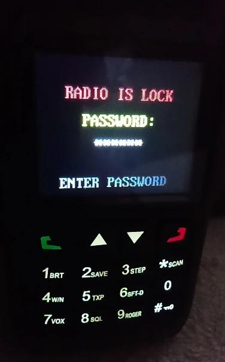

# PIN-блокировка HG-UV98 (патч прошивки V1.1)

[RU](README.md) | [EN](README.en.md)

При включении рация показывает экран `RADIO LOCK` и не запускается, пока с клавиатуры не введён правильный PIN. 
После верного кода снова рисуется bootscreen и загрузка продолжается штатно.

PIN (4–6 цифр) задаётся при запуске скрипта и зашивается в образ.

## Клавиши

| Код | Клавиша | Действие |
|---|---|---|
| 0–9 | цифры | ввод символа |
| 10 | MENU | подтвердить PIN |
| 13 | AB / BACK | стереть последний символ |
| 11, 12 | UP / DOWN | игнорируются |
| 14, 15 | `*`, `#` | игнорируются |

Проверка выполняется **только по MENU**, автоматической сверки по длине нет.
Если нажать MENU при введённых цифрах, но длина не совпадает с PIN — это
ошибка. Выйти из блокировки нельзя.

Коды взяты из восстановленных таблиц: 10 = MENU, 11/12 = вверх/вниз, 13 = BACK, 14/15 = `*`/`#`.

## Что меняется в образе

| Что | Файл | Адрес | Было | Стало |
|---|---|---|---|---|
| Хук в загрузочной сцене | 0x177A8 | 0x0801B7A8 | `adds.w r7, r5, #0x142` | `b.w 0x0804A000` |
| Payload | 0x46000 | 0x0804A000 | 0xFF (стирание) | 2924 байта |

Больше ни один байт не меняется — проверено побайтовым диффом
(диапазон 0x177A8…0x46B6B, 2891 отличающихся байт).

## Как устроено

* Хук стоит сразу после вывода заставки.
* Стаб выполняет вытесненную инструкцию и возвращается в 0x0801B7AC.
* Отрисовка — напрямую в панель: `display_set_window` 0x0801B9B0,
  `tft_write_cmd` 0x0801BA52, `tft_write_byte` 0x0801BA74 — та же
  последовательность, что у штатной `display_fill_rect`, включая PC2.
  Никаких буферов на стеке: кадр функции ≤ 48 байт (стек задачи ~1 КБ).
  Свой шрифт 8×16 (1520 байт) вшит в payload.
* Ввод — `key_scan` 0x0802819A (обходит блокировку клавиатуры настроек).
* Если `ADC2.CR2.ADON = 0`, вызывается штатная инициализация АЦП
  0x080294F8 — иначе ожидание EOC в скане клавиш не завершается.
* После пароля: `display_blit_image(0, 0, 128, 160, 0x08004130, 0xA000)` —
  bootscreen.

## Структура файлов

Патч собирается из исходников, а готовый payload зашивается прямо в
`patch_password.py`, поэтому для патча тулчейн не нужен.

| Файл | Что это | Отвечает за |
|---|---|---|
| `patch_password.py` | Патчер (главный скрипт) | Зашивает PIN в образ: вставляет payload в область 0x46000, ставит хук `b.w` в 0x0801B7A8, сверяет встроенный payload по MD5. Содержит готовый payload (hex) + PIN-слот. Для работы достаточно Python 3 без тулчейна |
| `payload.c` | Исходник payload на C | Логика блокировки: отрисовка экрана PIN, ввод с `key_scan`, проверка кода, bootscreen после успеха. Работает в свободной области 0x0804A000 |
| `pinblob.c` | PIN-слот (отдельный unit) | Массив `pin_blob[16]`: магия `PWN1`, длина, цифры, XOR-контроль. Вынесен в отдельный файл, чтобы GCC не свернул патченые байты в константу и не выкинул код |
| `start.S` | Точка входа payload | Стаб: сохраняет регистры, вызывает `pin_gate()`, выполняет вытесненную инструкцию и возвращается в 0x0801B7AC |
| `font.S` | Подключение шрифта | Включает `font8x16.bin` в секцию `.rodata` как `font8x16` |
| `font8x16.bin` | Шрифт 8×16 (1520 байт) | ASCII-глифы для всех надписей на экране |
| `link.ld` | Скрипт линковки | Раскладывает секции с адреса 0x0804A000: `.text`, `.rodata`, `.pinblob`, `.data` |
| `payload.bin` | Собранный payload (готовый) | Результат сборки: `arm-none-eabi-gcc … && objcopy`; кладётся в образ патчером |
| `dist\patch_password.exe` | Готовый патчер (Windows) | Самодостаточный exe: встроен Python + payload, тулчейн и Python **не нужны**. Запускается там же, где лежит, или из любой папки, если указать полный путь |
| `fw_v1.1_2DKXCE.bin` | Исходный дамп прошивки V1.1 | Входной образ для патча; не изменяется |
| `README.md` | Документация | Этот файл |

Схема сборки payload:

```text
start.S + payload.c + pinblob.c + font.S + font8x16.bin
    +---------------------+----------------+
    v                                        |
 arm-none-eabi-gcc -O0 -T link.ld            |
    v                                        |
 payload.elf                                |
    | objcopy -O binary                     |
    v                                        |
 payload.bin -------------------------------+
    |
    +-> patch_password.py (встроен hex+MD5-сверка)
        |
        v
fw_v1.1_2DKXCE.bin  ->  patch_password.py --pin 1234 -o locked.bin
                        |
                        v
                   locked.bin (патченый образ)
```

## Примеры использования (запуск)

Скрипт работает на любом Python 3 без тулчейна — готовый payload уже
встроен в `patch_password.py`.

Справка:

```bat
python patch_password.py --help
```

Запатчить образ, указав PIN в командной строке:

```bat
python patch_password.py fw_v1.1_2DKXCE.bin --pin 1234 -o locked.bin
```

Пример вывода:

```text
Image: original, no PIN lock.

Done.
  image:      locked.bin
  size:       507904 bytes
  PIN:        4 digits (stored in the image, plaintext)
  payload:    0x0804A000, 2924 bytes
  hook:       0x0801B7A8 -> 2ef02abc
  input md5:  a5f4d0edf8991dc8e5c89891beab1872
  output md5: e3ee395d878851f3c147cd9caa5299a2

Flash via IAP 'Download Image', COM 115200 8N1, file locked.bin
```

Если `--pin` не задан, скрипт спросит пароль интерактивно (ввод не
экранируется, это просто строка):

```bat
python patch_password.py fw_v1.1_2DKXCE.bin
```

```text
Radio password (4-6 digits): 123456
```

Если без `-o`, выходной файл создаётся рядом с исходным под именем
`<имя_без_расширения>_locked.bin`.

Проверить образ (оригинал, патченый или чужой):

```bat
python patch_password.py fw_v1.1_2DKXCE.bin --check
python patch_password.py locked.bin --check
```

```text
Image: original, no PIN lock.
Image: PATCHED (PIN lock active).
```

Неверный PIN (не 4–6 цифр) отклоняется ещё на вводе:

```bat
python patch_password.py fw_v1.1_2DKXCE.bin --pin 12a
```

```text
Error: PIN must be 4-6 digits.
```

`--force` позволяет пропатчить образ, чьи байты хука не совпадают с
известными (например, после экспериментов) — пользуйтесь осознанно:

```bat
python patch_password.py unknown_image.bin --pin 1234 --force
```

### Готовый exe (без Python)

В папке `dist\` лежит собранный `patch_password.exe` — самодостаточный
Windows-бинарник со встроенным Python и payload. Для него **не нужны** ни
тулчейн, ни установленный Python: работает на любой Windows x64.

Из папки `dist`: `--help`, флаги и пример вывода — всё, как у скрипта выше.

```bat
cd dist
patch_password.exe ..\fw_v1.1_2DKXCE.bin --pin 1234 -o locked.bin
patch_password.exe ..\locked.bin --check
```

Можно запускать из любой папки, указав полный путь:

```bat
"C:\...\pinpatch\dist\patch_password.exe" fw_v1.1_2DKXCE.bin --pin 1234 -o locked.bin
```

Бинарник — точная копия `patch_password.py` по поведению: тот же встроенный
payload, MD5-сверки и тексты вывода (см. примеры выше).

## Сборка payload

```bat
arm-none-eabi-gcc -mcpu=cortex-m3 -mthumb -O0 -ffreestanding -fno-builtin ^
  -fno-common -nostdlib -nostartfiles -Wl,-T,link.ld -Wl,--gc-sections ^
  -o payload.elf start.S payload.c pinblob.c font.S
arm-none-eabi-objcopy -O binary payload.elf payload.bin
```

**Важно:** только `-O0`. На `-O1`/`-Os` GCC считает функции, вызываемые через
указатели на фиксированные адреса, «чистыми» и удаляет вызовы — payload
сжимается до 84 байт и превращается в пустой цикл. `-fno-ipa-pure-const`
помогает лишь частично (пропадают строки). `-O0` собирает всё корректно.

`pin_blob` вынесен в отдельный `pinblob.c`, чтобы компилятор не свернул
патченые байты в константу.

`patch_password.py` содержит готовый payload в hex с MD5-сверкой, поэтому для
патча тулчейн не нужен.

## Ограничения

* Только дамп **V1.1** (507 904 байта). Скрипт проверяет байты хука и
  откажется работать с другим образом.
* Блокируется UI и клавиатура главного МК. APRS-сопроцессор STC8 живёт
  отдельно — его передачу патч не отключает.
* PIN хранится открыто (это замок от случайного включения, не криптозащита).
* Загрузчик не затрагивается: откат — залить исходный дамп.

## Проверено

* размер образа не меняется (507 904);
* меняются только 4 байта хука и область payload;
* payload в образе побайтово равен `payload.bin` (кроме PIN-слота);
* указатели вызовов — с Thumb-битом;
* `b.w` декодируется ровно в 0x0804A000;
* PIN-слот: магия `PWN1`, длина, цифры, XOR-контроль;
* повторный патч уже пропатченного образа работает;
* PIN валидируется: 3 цифры, 7 цифр и буквы отклоняются;
* встроенный payload сверяется по MD5 при каждом запуске.
* на рации работает.

## История исправлений

1. В первой сборке встроенный payload разошёлся с собранным на один байт:
   указатель `key_scan` остался чётным → `blx` в ARM-состояние → HardFault
   на первом нажатии. Исправлено, добавлена MD5-сверка.
2. Во второй версии GCC на `-Os` удалил все вызовы отрисовки (см. выше) —
   сборка переведена на `-O0`.
3. Третья версия рисовала через буферы 256 Б на стеке — переполнение стека
   задачи, плата показывала только загрузочный логотип. Отрисовка переведена
   на прямую запись пикселей без буферов.
4. В четвёртой версии была перепутана полярность CS: хелпер `0x08023770`
   пишет в **BRR** (сброс), `0x08023768` — в **BSRR** (установка), то есть
   штатный код сначала сбрасывает PC1, а в конце устанавливает. Из-за
   обратного порядка панель игнорировала весь поток: экран оставался на
   заставке, хотя ввод PIN работал.

## Фото


   
----

(c) dkxce https://github.com/dkxce
